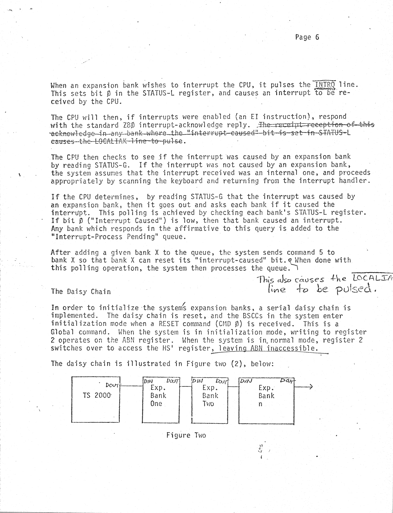

<!-- PDF page 1 (no printed page number) -->

FUNCTIONAL SPECIFICATION
BANK SWITCHING CONTROLLER CHIP
==============================

> *Transcriber's note:* "DAVID BOYLE" is handwritten in capitals at the top right of page 1, above the typed text. The typed page has "FUNCTIONAL SPECIFICATION" centred near the top and "BANK SWITCHING CONTROLLER CHIP" lower down at the left margin, above the "By:" line; both are combined in the heading above. There is no page number on page 1.

> *Transcriber's note:* In places, the typist used a slashed zero (Ø) for the digit zero. Examples are register 0 in Figure One, the addresses in the page 2 example (`EØØØh`, `AØØØh`), `ØØØØ-1FFFh`, `Z8Ø`, bit Ø and command Ø. Other places use a plain 0 (`4000h`, `A000h`, `2000-3FFFh`, `TS 2000`). Every slashed zero is transcribed here as the digit `0`. No letter O appears in any hex value.

By:  David B. Ornstein (5239)

A chip is designed to support bank switching in an expansion bank.  This document describes the functions supported by the chip.  It is assumed that the reader is familiar with bank switching as implemented on the TS 2000.

## ADDRESSING

The bank switching controller chip (BSCC) contains 4 memory-mapped I/O ports.  These I/O ports, and their functions are shown in figure one below:

| REG | ADDR | READ | WRITE |
|-----|------|------|-------|
| 0 | 4000h | HS-LSN | HS |
| 1 | A000h | HS-MSN | BNA |
| 2 | C000h | STATUS-L | ABN/HS' |
| 3 | E000h | STATUS-G | CMD |

Figure One

The functions listed in the READ and WRITE columns access internal registers within the BSCC.  These registers are described, in detail, below in the section titled Register Functions.

The BSCC operates in an environment controlled by a 4-bit data bus.  The notations LSN (least-significant-nybble), and MSN (most-significant-nybble) are used freely throughout this document.

## REGISTER FUNCTIONS

### BNA - Bank Number Accessed

Each bank has associated with it a unique Bank Number.  This number (stored in the ABN register - see below)  is assigned to the bank by the operating system during the system initialization phase, and is 8-bits wide.

The functional domain, under which bank switching on the TS 2000 occurs, may be divided into two sections.  The first type of operation is called GLOBAL.  A Global operation is an operation that is performed on all banks.  The second type of operation is called LOCAL.  A Local operation is performed only on a single, specified bank.

<!-- PDF page 2 (printed page "Page 2") -->

To facilitate specification of this single bank, an 8-bit register is implemented in each bank.  This is the BNA register.  Writing to the BNA register is a Global operation.

The bank in which a requested Local operation is to occur is determined by comparing the BNA register with the bank number assigned to each bank during initialization.  The bank in which this comparison yields true is the bank in which the operation will occur.

Because the BSCC operates in a 4-bit wide environment, steering logic is utilized to control the writing of a byte to an 8-bit internal register.

An example of the scheme used is shown below:

```asm
                                ; Write number in
                                ; D register to
                                ; BNA register

        LD   A,2
        LD   (E000h),A          ; Reset steering
                                ; logic
        LD   A,D                ; Get data
        LD   (A000h),A          ; Write LSN
        LD   A,D                ; Get data
        SRA  A                  ; Shift right
        SRA  A                  ; 4 bits
        SRA  A                  ;
        SRA  A                  ;
        LD   (A000h),A          ; Write MSN
```

The two (2) written to E000h (register 3) is used to reset the steering logic so that the first nybble written will be placed in  the LSN of the destination register.  After writing the LSN, the next received nybble, at the same address, will be placed in the MSN of the destination register.  The following registers utilize this nybble-steering scheme:

ABN  -  Assigned Bank Number\
BNA  -  Bank Number Accessed\
HS  -  Horizontal Select\
HS'  -  Horizontal Select (Protect Mode)

<!-- PDF page 3 (printed page "Page 3") -->

### ABN -  Assigned Bank Number

As described above, each bank has associated with it a unique bank number.  That number is stored within the ABN register.

### HS -  Horizontal Select

The horizontal select register is used to specify which chunks are enabled within the given bank.  Bit 0 corresponds to 0000-1FFFh.   Bit 1 corresponds to 2000-3FFFh, and so forth.

Writing to the HS register will cause the data being written to be latched into the current bank  (i.e., ABN=BNA).

### HS' - Horizontal Select (Protect Mode)

If, within two different banks, the same chunk is enabled and then an address within that chunk is accessed, both banks will respond to the access.  This may have unpredictable effects.

Conceptually the method that should be utilized to avoid this "Horizontal Conflict" is effected by performing the following actions:

1. Want to write data in D register to HS of bank E.

2. For index = 1 to Maxbank.

3. Read back current Horizontal Select value for bank number index.
   If any bit in D is set in the read-back HS data, then reset the corresponding bit in the read-back HS data byte.
   Write back the new "protected" HS data to bank index.

4. Next index.

5. Write out D to HS in bank E.

If performed in software, this function will take quite a substantial period of time.  Thus, a decision was made to support this "protect-mode" function in the BSCC.

<!-- PDF page 4 (printed page "Page 4") -->

Writing to the HS' register operates in the same way that writing to HS does, with one exception:  any expansion bank that is not the one currently active (i.e., BNA=ABN), will take the data being written to HS', and turn off the appropriate bits in their Horizontal Select registers.

With this scheme in place, it is suggested that only the HS' register should be written to, and that, excepting unforeseeable circumstances, the HS  register should not be written to.

### HS-LSN   Horizontal Select LSN Read-back

By reading this register, the programmer may determine the LSN of the currently active bank.

### HS-MSN   Horizontal Select LSN Read-back

By reading this register, the programmer may determine the LSN of the currently active bank[handwritten: 's HS register.]

### HS-MSN   Horizontal Select MSN Read-back

By reading this register, the programmer may determine the MSN of the currently active bank[handwritten: 's HS register.]

> *Transcriber's note:* In both HS-MSN paragraphs, the typed text ends "active bank." and the handwritten "'s" is written over the typed period. The HS-LSN paragraph has no handwritten addition. The page has two consecutive headings typed "HS-MSN": the first one says "LSN" in its heading and its text, and the second says "MSN". This is transcribed as printed.

### CMD  -  Command Register

Through this register, various commands may be issued to the BSCCs in the system.  Table One, below, shows the command implement in the BSCC.

| Command | Name | Function |
|---------|------|----------|
| 0 | RESET | Reset daisy chain, and enter initialization mode. |
| 1 | STEP | Step to next unit in the daisy chain |
| 2 | LOWNYB | Reset nybble - steering logic |
| 3-4 | --- | Reserved |
| 5 | RINT | Reset interrupt-caused flag |
| 6-15 | --- | Unused |

Table One

<!-- PDF page 5 (printed page "Page 5") -->

The RESET and STEP commands are described in the section entitled The Daisy Chain.  The LOWNYB command, as described under BNA, is used to reset the nybble-steering logic.   The RINT command is described in the section entitled Interrupts.

### STATUS-L  -  Local Status

Each bank has associated with it an internal 4-bit status register.  The reading of this register is clearly a Local operation.  The function of each bit is described below.  An overview of the available functions is given below in Table Two

| Bit | Function |
|-----|----------|
| 0 | Interrupt Caused (Active Low) |
| 1 | Not Used |
| 2 | Bank Responding (Active Low) |
| 3 | INIT mode (Active High) |

Table Two

The Interrupt Caused bit is described in the section entitled Interrupts.  The Bank Responding, and INIT mode bits are described in the section entitled The Daisy Chain.

### STATUS-G  -  Global Status

The function of the Global Status register is to allow the TS 2000's system software to determine, quickly, whether for any received interrupt, that interrupt was caused by an expansion bank.

If any expansion bank did cause the interrupt, then that bank (or those banks) will pull bit 2 of the STATUS-G register low.

## INTERRUPTS

This section will describe the facility of the BSCC to support a bank-oriented interrupt structure.  On  the BSCC, there are two pins which support bank-oriented interrupts; <span style="text-decoration:overline">INTRQ</span>, and <span style="text-decoration:overline">LOCALIAK</span>.

> *Transcriber's note:* The signal names INTRQ and LOCALIAK are typed with an overbar, which marks them as active-low. The overbars are kept above as HTML overline spans, which may not display in every markdown viewer. Because the overbars run right under the line above, "On" and "BSCC, there" look underlined in the scan. They are not underlined.

<!-- PDF page 6 (printed page "Page 6") -->

When an expansion bank wishes to interrupt the CPU, it pulses the <span style="text-decoration:overline">INTRQ</span> line.  This sets bit 0 in the STATUS-L register, and causes an interrupt to be received by the CPU.

> *Transcriber's note:* On this page, INTRQ is typed with an overbar. A short vertical stroke at its left end makes the overbar look like part of a box. There is also a wavy handwritten line under the word.

The CPU will then, if interrupts were enabled (an EI instruction), respond with the standard Z80 interrupt-acknowledge reply.  ~~The receipt reception of this acknowledge in any bank where the "interrupt-caused" bit is set in STATUS-L causes the LOCALIAK line to pulse~~.

> *Transcriber's note:* The sentence "The receipt reception of this … to pulse" is struck through by typewriter overstrike: a level row of hyphens, one per character. The final period is not struck. In the struck text, LOCALIAK has no visible overbar.

The CPU then checks to see if the interrupt was caused by an expansion bank by reading STATUS-G.  If the interrupt was not caused by an expansion bank, the system assumes that the interrupt received was an internal one, and proceeds appropriately by scanning the keyboard and returning from the interrupt handler.

If the CPU determines,  by reading STATUS-G that the interrupt was caused by an expansion bank, then it goes out and asks each bank if it caused the interrupt.  This polling is achieved by checking each bank's STATUS-L register.  If bit 0 ("Interrupt Caused") is low, then that bank caused an interrupt.  Any bank which responds in the affirmative to this query is added to the "Interrupt-Process Pending" queue.

After adding a given bank X to the queue, the system sends command 5 to bank X so that bank X can reset its "interrupt-caused" bit. [handwritten: This also causes the <span style="text-decoration:overline">LOCALIA</span>[cut off at the right edge of the scan] line to be pulsed.] When done with this polling operation, the system then processes the queue.

> *Transcriber's note:* The handwritten note is in the right margin between this paragraph and "The Daisy Chain". A handwritten insertion mark after "bit." connects to it with a line. The overbar over "LOCALIA…" is handwritten. The rest of the word is cut off at the edge of the scan; it is presumably LOCALIAK.

## The Daisy Chain

In order to initialize the system[handwritten: ']s expansion banks, a serial daisy chain is implemented.  The daisy chain is reset, and the BSCCs in the system enter initialization mode when a RESET command (CMD 0) is received.  This is a Global command.  When the system is in initialization mode, writing to register 2 operates on the ABN register.  When the system is in normal mode, register 2 switches over to access the HS' register, leaving ABN inaccessible.[handwritten: the words "leaving ABN inaccessible." are underlined by hand]

The daisy chain is illustrated in Figure two (2), below:



*[Diagram: four boxes in a row joined by lines. The TS 2000 box's DOUT connects to the DIN of Exp. Bank One. Each bank's DOUT connects to the DIN of the next bank. An arrow leaves the DOUT of Exp. Bank n.]*

- Box 1: "TS 2000" (typed); "DOUT" (handwritten) at the right edge
- Box 2: "Exp. Bank One" (typed); "DIN" and "DOUT" (handwritten) at the top left and top right
- Box 3: "Exp. Bank Two" (typed); "DIN" and "DOUT" (handwritten) at the top left and top right
- Box 4: "Exp. Bank n" (typed); "DIN" and "DOUT" (handwritten) at the top left and top right; an arrow points right out of DOUT
- Caption (typed): "Figure Two"

> *Transcriber's note:* The boxes and connecting lines are drawn by hand. Box 2's labels read "DIN DOUT". In boxes 3 and 4, the handwritten "DOUT" is partly unclear but has the same form as the others.

<!-- PDF page 7 (printed page "Page 7") -->

When initialization mode is entered~~[,?] the ABN[?] register is set to [illegible]~~ The Horizontal Select register is reset to "all-Chunks off".

> *Transcriber's note:* The struck words are heavily overstruck, which makes them hard to read. "the ABN register is set to" is a best reading. The last word or words cannot be read.

When in initialization mode, only one bank is active at a time.  Upon RESET, Expansion Bank One (the first in the Daisy Chain) is active, and all other expansion banks are not.  With each successive STEP command issued, the next bank in the chain becomes active and the one before it becomes inactive.

After each STEP command, the system shall read STATUS-L, and look at bit 2.  If bit 2 is high, then there are no more banks in the daisy chain, and the BSCCs have automatically reset themselves to "Normal" mode.

The system's mode of operation may be determined by looking at bit 3 of STATUS-L.  If this bit is high, then the system is in Initialization mode.  If this bit is low, then the system is in Normal mode.

DO:cm
