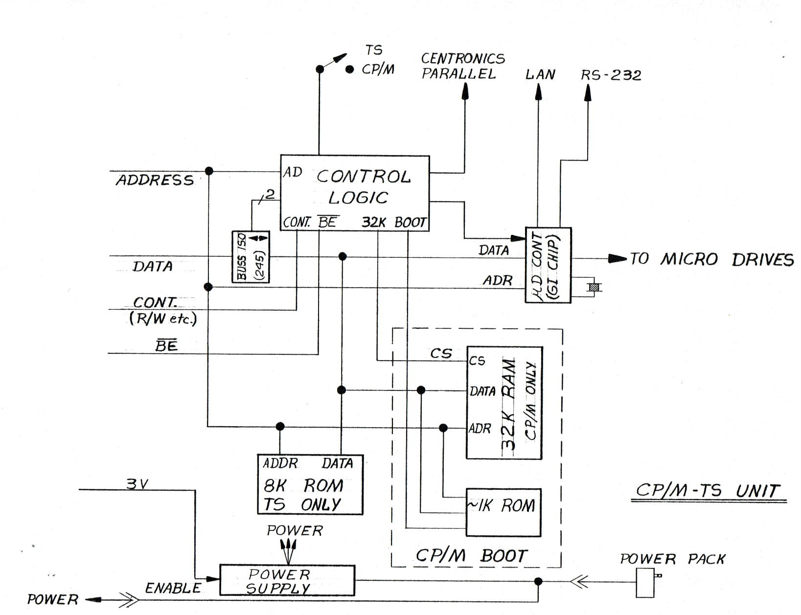
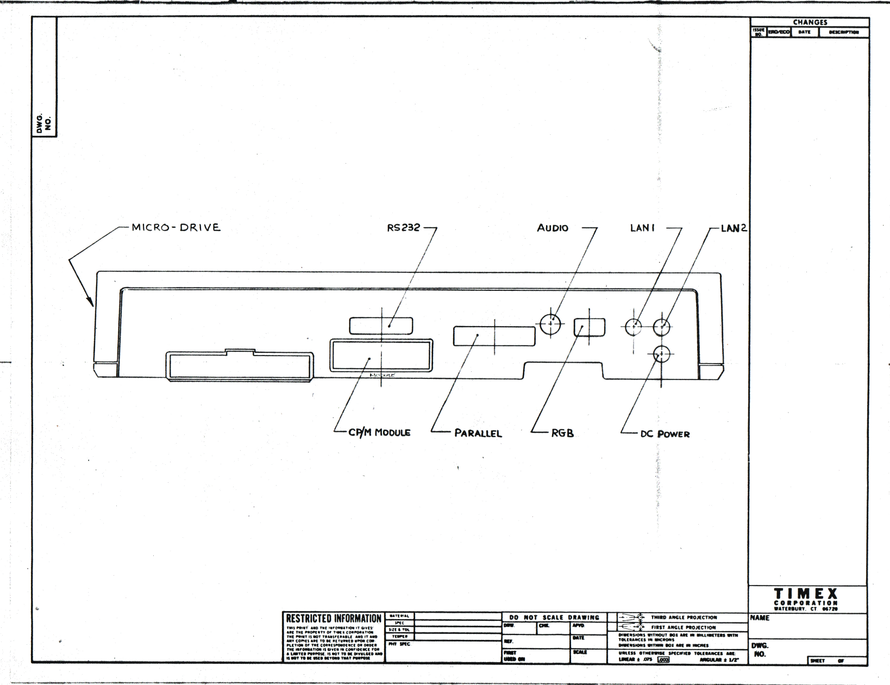
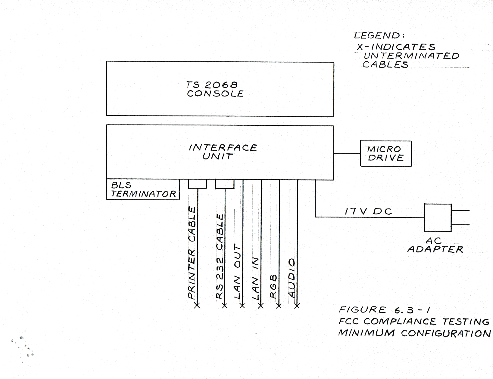
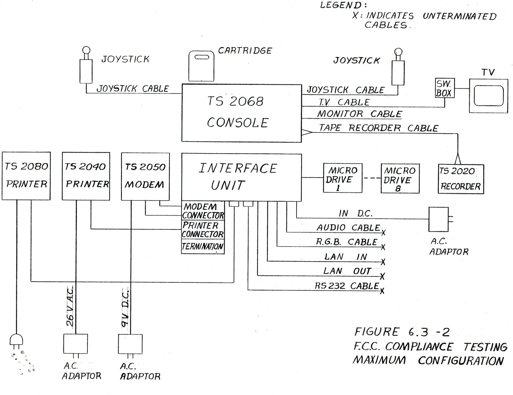

<!-- PDF page 1 (title page; no printed page number) -->

# TS2060 INTERFACE PRODUCT SPECIFICATION

JANUARY 24,1984

> *Transcriber's note:* The title page carries a red rubber-stamp impression reading "PRELIMINARY", below and to the right of the date. No other text on the page.

<!-- PDF page 2 (no printed page number) -->

> *Transcriber's note:* The top line of the running header ("TS2060 INTERFACE") is partly cut off by the scan on this page and the next.

TABLE OF CONTENTS

- 1.0 Scope
- 2.0 Applicable Documents
- 3.0 Product Overview
  - 3.1 Mass Storage/ Controller
  - 3.2 CP/M Module
  - 3.3 Printer Interface
  - 3.4 RS-232-C Interface
  - 3.5 Local Area Network
  - 3.6 RGB Output
  - 3.7 Audio Output
  - 3.8 System Buss Expansion
- 4.0 Hardware Description
  - 4.1 Figures
    - 4.1.1 Block Diagram
    - 4.1.2 Connector Locations
  - 4.2 Unit Specifications
  - 4.3 Interfaces
    - 4.3.1 Microdrive
    - 4.3.2 Printer
    - 4.3.3 RS-232-C
    - 4.3.4 Local Area Network
    - 4.3.5 R G B
    - 4.3.6 Audio
    - 4.3.7 System Buss Expansion

  <!-- PDF page 3 (printed page "Pg. 2") -->

  - 4.4 CP/M Module
  - 4.5 Power Supply
  - 4.6 I/O Port Map
  - 4.7 Memory Map
- 5.0 Software Description
  - 5.1 TIMEX/SINCLAIR Basic Support
  - 5.2 CP/M Support
  - 5.3 Machine Language Support
  - 5.4 Error Handling
- 6.0 Regulatory Requirements
  - 6.1 UL Requirements
  - 6.2 CSA Requirements
  - 6.3 FCC Requirements

<!-- PDF page 4 (printed page "Pg. 3") -->

## 1.0 Scope

This product specification describes the TS2060 Interface Unit, Drives, and associated Software. The functional, physical, electrical, and environmental characteristics are specified. A description of the operation of the TS2068 system with this unit is included.

## 2.0 APPLICABLE DOCUMENTS

- TS2068 Product Specification
- TS2000 System Software Functional Specification
- TS2000 System Software Architecture Specification
- Timex Microdrive Operating System Functional Specification
- Timex Microdrive Operating System Architecture Specification
- TS2065 Microdrive Transport Specification
- TS2070 Microdrive Cartridge Sspecification
- TS2070 Microdrive Tape Format Specification
- CP/M for Microdrive Specification
- TS2060 Qualification Test Procedure
- TS2060 Marketing Design Guide

<!-- PDF page 5 (printed page "Pg. 4") -->

## 3.0 Product Overview

The TS2060 Interface Unit provides the electronics, connectors, and firmware to adapt the TS2068 Computer to control:

(a) Up to 8 TS2065 Microdrive transports

(b) CP/M Module - a RAM/ROM plug-in to extend the unit to support the CP/M operating system on the TS2068.

(c) A printer - Centronics parallel interface.

(d) RS-232-C interface - for attachment of compatible non - Timex peripherals. ( 9 wire )

(e) Local Area Network - for interconnection of up to 64 TS2068 computers via the Sinclair 2 wire circuit.

(f) System Buss Expansion - a 64 pin connector on the rear of the unit with the system buss buffered to drive up to six additional loads.

Outputs will also be provided for:

(a) R G B Monitor - TTL level drive with composit and vertical sync.

(b) Audio - buffered low level output for external amplifier.

The design of the Interface Unit is being executed initially in LS-TTL to speed first production deliveries. As work progresses a parallel effort is planned to provide a cost reduced version in gate array techonology. The cabinetry and many of the circuits are being designed to allow inclusion of a controller for Floppy Disc drives. At this time it is not known if both Microdrives and Floppy Discs can be incorporated together or if one must replace the other.

### 3.1 Mass Storage/ Controller

The Microdrive Mass Storage subsystem consists of 1 to 8 Microdrive transports and the control circuitry and firmware included in the Interface Unit. Microdrive Transports are connected daisy- chain fashion to the control unit, receiving control, data, and power over a single flat cable.

Each Microdrive Transport accommodates a removable endless loop tape castridge capable of storing at least 85k bytes of program, data, or memory images organized as files. The
<!-- PDF page 6 (printed page "Pg. 5") -->
tape cartridge holds 200 inches of magnetic tape that moves at 30 inches per second when necessary to perform read/ write/ search functions. Data is recorded on the tape in two tracks in an FM format at approximately 3333 bpi acheiving a data rate of approximately 12.5k bytes per second. Sectoring is completly soft with a sector length of 512 formatted data bytes.

The controller unit includes circuitry to select an individual Microdrive transport, and to interface data and control signals between the TS2068 computer and the selected transport. Data seperation, track selection, serialization/deserialization, read/write control, and erase control functions are performed by the controller. Firmware in the form of a 16k byte ROM is included to permit control of the Microdrive(s) from the TS2068 keyboard using the appropriate 'keywords' already imprinted. Extensions to the Timex/ Sinclair are provided in the firmware to support a channel/ data stream mechanism. An automatic mechanism is implemented for selection/ deselection of the ROM.

### 3.2 CP/M Module

An optional module can be plugged into the interface unit to extend the operation of the system to accommodate the CP/M operating system. The CP/M module consists of a plug in card with 32k bytes of dynamic RAM and a 1K byte ROM installed. Incorporated into the ROM is the 'cold boot' loader program necessary for system startup in the CP/M mode. The RAM is switched into the system under software (I/O port) control to enable a 64k byte contiguous RAM space starting from address [0h? Oh?]. This architecture is necessary to support the CP/M operating system. A switch and logic is provided in the interface unit to allow this mode of operation upon power-up. The operating system program is loaded from microdrive tape and runs out of RAM. Thereafter the operating system functions usually performed by disk drives are performed on the microdrive tape.

### 3.3 Printer Interface

The printer interface is an industry standard Centronics Parallel type. Support is provided in the firmware for the Timex TS2080 dot matrix impact printer or other Centronics compatible printers. A 34 conductor connector is provided.

Access to the interface port is supported by either of two channels; The 'C' channel for listings or character oriented data and the 'G' channel for graphics data. The 'G' channel sends the full 8 bit data allowing control codes to be sent directly to the attached printer. The 'C' channel will not send control codes.

<!-- PDF page 7 (printed page "Pg. 6") -->

### 3.4 RS-232-C Interface

An abbreviated 9 wire (common industry practice) RS-232-C interface that operates at baud rates from 50 to 19,200 is provided. The standard DB-25 connector is located at the rear of the unit. The mode of operation is half-duplex wth one start bit, one stop bit, and without parity. Attachment of serial printers, modems and other compatible devices is therefore allowed.

Access to the RS-232-C port is supported by either of two channels; The 'T' channel is normally used for listings and other ASCII character oriented data. The 'B' channel is used to send full 8 bit codes for memory images or control codes.

### 3.5 Local Area Network

The local area network allows linking up to 64 Interface Unit equipped TS2068 computers in a daisy chain fashion with up to 100 meters of interconnect cables total. A network capable transferring programs, data, and messages at 87k baud is thereby formed. Transmission between individual computers is supported along with a broadcast mode .

Access to the network is supported in the firmware via the 'N' channel.

### 3.6 R G B Output

The R G B output provides positive TTL level signals to drive a compatible monitor. Red, Green, Blue, and sync signals are developed. Higher resolution (horizontal) than can be displayed on a television set is achieved. A 9 pin 'D' female style connector is used and a cable (not supplied) will be required to connect the monitor to the interface unit.

### 3.7 Audio Output

The audio output connector, a standard RCA phono jack provides a low level buffered signal to allow connection of an external amplifier and speaker for increased sound level. The internal speaker in the associated TS2068 is not muted.

### 3.8 System Buss Expansion

The TS2068 expansion buss is buffered and brought out to a connector on the back of the Interface Unit. The connector is the same as and is in the same position as the expansion connector on the TS2068 console. Peripherals may be attached up to the limit of 6 LS-TTL loads in the same
<!-- PDF page 8 (printed page "Pg. 7") -->
fashion as to the TS2068. Control logic is provided to prevent buss contention with signal sources in the Interface Unit and in the TS2068. When not in use the expansion buss connector opening may be covered with the door supplied with the TS2068.

## 4.0 Hardware Description

The following hardware description should be used in conjunction with the apppropriate drawings and specifications listed in section 2.0.

<!-- PDF page 9 (no printed page number; drawing) -->

> *Transcriber's note:* This page is a hand-lettered drafted block diagram, drawn sideways (landscape) on the sheet; the render below has been rotated upright. It carries no running header, no page number and no figure number. It is inserted between "Pg. 7" and "Pg. 8"; the next page ("Pg. 8") has the heading "4.1.1 Block Diagram" followed only by "T B S". The labels inside the "µD CONT (GI CHIP)" and "32K RAM / CP/M ONLY" boxes are lettered vertically, at 90° to the rest of the drawing.

*[Diagram: block diagram of the interface unit, showing the TS2068 ADDRESS, DATA, CONT. and BE lines feeding a CONTROL LOGIC block, an 8K ROM, a µD CONT (GI CHIP) microdrive controller with Centronics, LAN and RS-232 outputs, a dashed "CP/M BOOT" group containing 32K RAM and ~1K ROM, and a power supply fed from a power pack.]*

Labels on the drawing, as printed:

- Title (underlined twice): CP/M-TS UNIT
- Incoming bus lines (left edge): ADDRESS; DATA; CONT. (R/W etc.); BE (with overbar)
- Bus isolator box (on the DATA line, bidirectional arrow): BUSS ISO (245); line from it to CONTROL LOGIC marked "2" with a slash (bus-width tick)
- Control logic box: CONTROL LOGIC; pin labels AD; CONT.; BE (with overbar); 32K; BOOT
- Switch on top of CONTROL LOGIC: TS; CP/M
- Outputs (arrows, top): CENTRONICS PARALLEL; LAN; RS-232
- Microdrive controller box: µD CONT (GI CHIP); inputs DATA (arrow from CONTROL LOGIC, and line from bus), ADR; crystal symbol attached to its side; output arrow: TO MICRO DRIVES
- ROM box: ADDR; DATA; 8K ROM; TS ONLY
- Dashed box: CP/M BOOT, containing:
  - 32K RAM; CP/M ONLY; pins CS, DATA, ADR; incoming line labelled CS
  - ~1K ROM
- Power: 3V (line into POWER SUPPLY); ENABLE; POWER SUPPLY; POWER (three arrows out of POWER SUPPLY); POWER (arrow pointing out at bottom left, with connector chevrons); POWER PACK (with connector chevrons)

<!-- PDF page 10 (printed page "Pg. 8") -->

### 4.1 Figures

#### 4.1.1 Block Diagram

T B S

<!-- PDF page 11 (no printed page number; Timex engineering drawing sheet) -->

> *Transcriber's note:* This page is an engineering drawing on a Timex Corporation drawing sheet, bound sideways (rotated 90°) between "Pg. 8" and "Pg. 9". It carries no figure number or title, and the title-block fields (NAME, DWG. NO., SHEET, CHANGES, DRW./CHK./APVD., etc.) are blank. The render below has been rotated upright.

*[Diagram: rear-elevation line drawing of the interface unit case, with leader lines naming each opening/connector on the rear panel.]*

Labels on the drawing (left to right along the rear panel):

- Above the case: MICRO-DRIVE (arrow pointing to the left end of the case), RS232, AUDIO, LAN1, LAN2
- Below the case: CP/M MODULE, PARALLEL, RGB, DC POWER
- Small faint lettering under the CP/M module opening: MODULE

Drawing-sheet text:

- Top left box: DWG. NO.
- CHANGES block: CHANGES; ISSUE NO.; ERO/ECO; DATE; DESCRIPTION
- Logo block: TIMEX CORPORATION WATERBURY, CT. 06720
- RESTRICTED INFORMATION — "THIS PRINT AND THE INFORMATION IT GIVES ARE THE PROPERTY OF TIMEX CORPORATION. THE PRINT IS NOT TRANSFERABLE AND IT AND ANY COPIES ARE TO BE RETURNED UPON COMPLETION OF THE CORRESPONDENCE OR ORDER. THE INFORMATION IS GIVEN IN CONFIDENCE FOR A LIMITED PURPOSE, IS NOT TO BE DIVULGED AND IS NOT TO BE USED BEYOND THAT PURPOSE" (fine print; punctuation [?])
- Material block: MATERIAL; SPEC; SIZE & TOL; TEMPER; FNT SPEC [?]
- DO NOT SCALE DRAWING; DRW.; CHK.; APVD.; REF.; DATE; FIRST USED ON; SCALE
- THIRD ANGLE PROJECTION; FIRST ANGLE PROJECTION
- DIMENSIONS WITHOUT BOX ARE IN MILLIMETERS WITH TOLERANCES IN MICRONS
- DIMENSIONS WITHIN BOX ARE IN INCHES.
- UNLESS OTHERWISE SPECIFIED TOLERANCES ARE: LINEAR ± .075 [boxed: .003]; ANGULAR ± 1/2°
- NAME; DWG. NO.; SHEET OF

<!-- PDF page 12 (printed page "Pg. 9") -->

#### 4.1.2 Connector Locations

T B S

<!-- PDF page 13 (printed page "Pg. 10") -->

### 4.2 Unit Specifications

#### 4.2.1 Mechanical

SIZE:  L= 15.7"   W= 6.2"  H= 2.6"\
WEIGHT:  3 lbs.  (approximately)\
COLOR:  Top; Silver  Bottom; Gray.  Per\
Industrial Design Specification

#### 4.2.2 Absolute Maximum Ratings

STORAGE TEMPERATURE:  -40 to +65 C.\
OPERATING TEMPERATURE: 0 to +50 C.\
RELATIVE HUMIDITY:  15% to 90%\
(Non-Condensing)\
POWER DISSIPATION: 10 W. MAX.\
POWER SUPPLY INPUT VOLTAGE:  25 VDC.\
SIGNAL INPUTS:\
    TTL LEVEL:  +5.5/ -0.5 Volts\
    RS-232-C:  +/- 25 V. Per EIA\
    LAN: 25 VAC max.\
OTHERS:  See Qualification Test Procedure.

### 4.3 Interfaces

#### 4.3.1 Microdrive Interface

The Microdrive Interface consists of a PCB edge connector on the right side of the Interface Unit of 8 dual sided positions.  The connections are numbered 1A to 8A on the component (top) side and 1B to 8B on the solder side.  Connection 1 is to the front (TS2068) end of the connector.  The connections are assigned as :

| Nr. | NAME | FUNCTION |
|-----|------|----------|
| 1A | RAW1 | Track 1 raw digital data, bidirectional |
| 2A | WRPRT | Write protect sense from selected drive |
| 3A | - - | Key slot |
| 4A | 10V | 10 VDC power for drive |
| 5A | R/W | Read-Write control to drive |
| 6A | GND | Ground |
| 7A | GND | Ground |
| 8A | GND | Ground |
| 1B | RAW2 | Track 2 raw digital data, bidirectional |
| 2B | CCLK | Select bit shift clock |
| 3B | - - | Key slot |
| 4B | CBIT | Select control bit |
| 5B | ERASE | Erase head current sink |
| 6B | GND | GROUND |
| 7B | GND | GROUND |
| 8B | GND | GROUND |

<!-- PDF page 14 (printed page "Pg. 11") -->

The Microdrive connection supports up to 8 drives.  The first drive is connected to the Interface Unit with a short flat cable.  Additional drives are connected to the first drive via connectors to be supplied with each drive.  Electrically all of the signals are in parallel except for the 'CBIT' line.  The 'CBIT' acts as the serial input to a shift register formed by the individual drives.  To select a particular drive, the 'CCLK' line is used to shift a one bit to a drive with the 'CBIT' line forming a daisy chain connection thru each drive.

The Microdrive control and data lines are all LS-TTL levels except for:

| | |
|---|---|
| 10V | Power supply to the drives, 10VDC nominal, 8.0V. min.,11.0V. max., 0.45A. peak, 0.25A max average |
| ERASE | Current sink from the erase winding of the selected drive.  20mA. nominal, 30mA. max, 10.8V. max. |

#### 4.3.2 Printer Interface

The printer interface is an 8 bit parallel 'Centronics' type capable of driving industry standard printers with this interface.  Connection is made to the interface via an edge connector of 36 signals in two rows.  A cable with an Amphenol type 57-30360 connector on the printer end and an header type connector on the computer end is required.  The interface is capable of driving up to a two meter cable.  Signal levels are standard LS-TTL levels.

Connections are assigned as:

| Nr. | NAME | FUNCTION |
|-----|------|----------|
| 1 | STROBE* | Output data strobe pulse, active low Pulse width is greater than .55 us. |
| 2 | DATA1 | True data output, parallel with DATA2 thru DATA8. |
| 3 | DATA2 | |
| 4 | DATA3 | |
| 5 | DATA4 | |
| 6 | DATA5 | |
| 7 | DATA6 | |
| 8 | DATA7 | |
| 9 | DATA8 | |
| 10 | ACK* | Active low input indicating that printer has received data and can accept next data byte.  Minimum width to be 4 us. |

<!-- PDF page 15 (printed page "Pg. 12") -->

| Nr. | NAME | FUNCTION |
|-----|------|----------|
| 11 | BUSY | Active high input indicates that printer cannot receive data. |
| 12 | NC | Not used |
| 13 | SLCT | Active high input indicating the printer is selected, ie; on-line. |
| 14 | NC | Not used. |
| 15 | KEY | Connector Key Location |
| 16 | GND | Signal Return Ground |
| 17 | F-GND | Frame Ground.  Chassis connection, not for signal return |
| 18 | NC | Not used. |
| 19 to 30 | | Signal return ground. |
| 31 | INIT* | Power on reset, active low output. |
| 32 | ERROR* | Active low input indicating printer error or failure. |
| 33 | KEY | Connector Key Location. |
| 34 to 36 | | Not used. |

> *Transcriber's note:* The printer table continues across the page break between PDF pages 14 and 15 (pins 1–10 on page 14, pins 11–36 on page 15). The column header row on page 15 is repeated by the transcriber so the continuation renders as a table; it is not printed there.

NOTES:
1. All signal levels are LS-TTL with rise and fall times less than 0.2 us.
2. Frame ground is for protective, shielding, and RFI purposes and must not be used as signal return.  This ground is not connected to the power line ground in the computer.
3. Signal names with a * as the last charcter are active low.

#### 4.3.3 RS-232-C Interface

The RS-232-C interface provided is a subset of the E.I.A. specified standard interface.  Signal levels accepted as inputs are standard levels as per the E.I.A..  Output levels are +/- 9V nominal and the inputs will accept TTL up to E.I.A levels.  Software selected baud rates supported range from 50 to 19,200.  Connection for the interface  is via a standard DB-25 style connector.  Depending on baud rate, up to 50 feet of cable can be drivin

The RS-232-C interface subset supported and pin assignments are as follows:

| Nr. | CIRCUIT | DESCRIPTION |
|-----|---------|-------------|
| 1 | AA | Protective Ground. |

<!-- PDF page 16 (printed page "Pg. 13") -->

| Nr. | CIRCUIT | DESCRIPTION |
|-----|---------|-------------|
| 2 | BA | Transmit Data. |
| 3 | BB | Received Data |
| 5 | CB | Clear To Send. |
| 6 | CC | +10V (Nominally data set ready) |
| 7 | AB | Signal Ground |
| 20 | CD | Data Terminal Ready |

> *Transcriber's note:* The RS-232-C table continues across the page break between PDF pages 15 and 16 (pin 1 on page 15, pins 2–20 on page 16). The column header row on page 16 is repeated by the transcriber; it is not printed there.

Notes:
1. Only those pin numbers assigned above are connected.  Pin assignments are per E.I.A. standard RS-232-C.
2. Data transmission is bit serial per E.I.A.
3. One stop bit and no parity is sent.  The data word is 8 bits long.
4. Protective ground is a frame connection only.  It is provided for protective, shielding, and RFI purposes only and must not be used as signal return.  This ground is not connected to the power line ground in the computer.

#### 4.3.4 Local Area Network

The local area network is a two wire connection using TTL levels in a 340 Ohm terminated twisted pair of up to 100 meters total length.  Two 3.5 mm. switching phone jacks connected in parallel are provided for connection.  The switching mechanism is arranged to connect 680 Ohm terminating resistor across unused jacks thereby terminating the network with 340 Ohms.  The one level on the network is achieved by active pull-up and the zero level by passive pull-down.  Data is sensed with a protected Schmidt trigger input.  Protection is sufficient to withstand 24 Volts AC.

The data rate (set by software in the TS2060 ROM) is approximately 87k baud.  Collision detection with psuedo-random back-off is employed.

#### 4.3.5 R G B  Output

TTL level outputs are provided to drive a RGB input monitor.  A sync seperator circuit in the interface generates composit sync and seperately vertical sync.  Those monitors that require horizontal sync can use the composit sync for this function.

The RGB and sync outputs are positive going TTL level.  The RGB outputs have sufficient bandwidth to accomodate the full 80 column output possible from the TS2068 and will drive a 2 meter cable.  The  RGB output does not support the BRIGHT mode of the TS2068.   Connection to the RGB output is via a 9 pin 'D' female connector on the back of the interface.

<!-- PDF page 17 (printed page "Pg. 14") -->

Signals are assigned to the RGB connector as follows:

| Nr. | NAME | DESCRIPTION |
|-----|------|-------------|
| 1 | CSYNC | Composit Sync |
| 2 | R | Red Video |
| 3 | G | Green Video |
| 4 | B | Blue Video |
| 5 | GND | Ground - Signal Return |
| 6 | GND | Ground as #5 |
| 7 | NC | Not Used |
| 8 | NC | Not Used |
| 9 | VSYNC | Vertical Sync |

#### 4.3.6 Audio Output

The audio produced by the TS2068 'BEEP' and 'SOUND' commands is buffered and routed to a standard RCA phono jack on the rear of the interface.  The output level, 0.5V into 10k Ohm, is sufficient to drive the auxiliary input of most HI-FI equipment.  Use of this output does not silence the speaker of the associated TS2068.

#### 4.3.7 System Buss Expansion

The data, address, and control signals of the associated TS2068 are buffered to increase the drive level to enable the system to drive up to 6 standard LS-TTL loads.  The buss expansion connector is a PC edge connection in the rear of the interface unit and is the same size and position as the buss connection on the TS2068.

Circuitry is provided for direction control of the data signals and to prevent external devices from interfering with the operation of either the Microdrive controller or the other interfaces in the unit.  Maximun access time of memory devices attached to the expansion buss is reduced by (XX) ns due to the propogation delay of the data, address, and control buffers.

<!-- PDF page 18 (printed page "Pg. 15") -->

The signals brought out in the buss expansion connector are:

| A SIDE Nr. | NAME | COMMENT | B SIDE Nr. | NAME | COMMENT |
|-----|------|---------|-----|------|---------|
| A1 | GND | GROUND | B1 | GND | GROUND |
| 2 | EAR | P/T | 2 | SP/T O | P/T |
| 3 | A7RB | BUFF | 3 | +15V | XX MA MAX |
| 4 | D7 | XCV | 4 | +5V | XX MA MAX |
| 5 | NC | NOT USED | 5 | NC | NOT USED |
| 6 | KEY | KEY SLOT | 6 | KEY | KEY SLOT |
| 7 | D0 | XCV | 7 | GND | GROUND |
| 8 | D1 | XCV | 8 | GND | GROUND |
| 9 | D2 | XCV | 9 | O* | CLK P/T |
| 10 | D6 | XCV | 10 | A0 | BUFF |
| 11 | D5 | XCV | 11 | A1 | BUFF |
| 12 | D3 | XCV | 12 | A2 | BUFF |
| 13 | D4 | XCV | 13 | A3 | BUFF |
| 14 | INT* | P/T | 14 | A15B | BUFF |
| 15 | NMI* | P/T | 15 | A14B | BUFF |
| 16 | HALT* | P/T | 16 | A13B | BUFF |
| 17 | MREQB* | BUFF | 17 | A12 | BUFF |
| 18 | IORQB* | BUFF | 18 | A11 | BUFF |
| 19 | RDB* | BUFF | 19 | A10 | BUFF |
| 20 | WRB* | BUFF | 20 | A9 | BUFF |
| 21 | BUSAK* | P/T | 21 | A8 | BUFF |
| 22 | WAIT* | P/T | 22 | A7 | BUFF |
| 23 | BUSRQ* | P/T | 23 | A6 | BUFF |
| 24 | RESET* | BUFF | 24 | A5 | BUFF |
| 25 | M1* | BUFF | 25 | A4 | BUFF |
| 26 | RFSHB* | BUFF | 26 | NC | NOT USED |
| 27 | EXROM* | P/T | 27 | R | BUFF |
| 28 | ROSCS* | P/T | 28 | G | BUFF |
| 29 | BE* | P/T | 29 | B | BUFF |
| 30 | IOA5 | P/T | 30 | NC | NOT USED |
| 31 | SOUND | BUFF | 31 | VIDEO | P/T |
| 32 | GND | GROUND | 32 | GND | GROUND |

> *Transcriber's note:* In this typeface the letter O and the digit zero are nearly identical. D0 (A7) and A0 (B10) are transcribed with zero as the data/address-line context requires. The B2 name is printed "SP/T O" and the B9 name "O*" exactly as shown; the round glyph in each could be read as letter O or digit 0 (the B9 entry, commented "CLK", is probably a typewriter stand-in for the clock signal Φ*, but it is not printed as Φ).

NOTES:
1. Signal names with * as the last character are active low.
2. Comment definitions;
   BUFF = buffered, if digital then 6 LS-TTL loads may be driven.\
   P/T = Pass through, signal is not modified.\
   XCV = Bi-directional buffering with controls for proper operation.  Tri-state high impedance state for TS2068 internal or interface unit read operations.
3. See the TS2068 product specification for complete description of signals and timing information.

### 4.4 CP/M Module

The requirements of the CP/M Operating system dictate

<!-- PDF page 19 (printed page "Pg. 16") -->
inclusion of additional RAM and ROM.  To support this the CP/M Module includes 32k bytes of dynamic RAM and a 1k byte ROM.  The ROM is enabled upon power-up when in the CP/M mode.  The ROM contains code forming the 'cold boot' loader.  Excecution of this code enables the system to load additional code from the number 1 microdrive transport into high memory.  Control is then passed to the additional code so loaded and this code disables the ROM by writing a bit to an I/O port (see section 4.6 for I/O port map).  Upon disabling the ROM in the CP/M mode the software then enables the 32k of additional RAM in the address range 0h to 7FFFh.  Whenever the system requires access to the display file memory or the 'HOME' ROM, the additional RAM is disabled by the software by means of a bit in an I/O port.

The CP/M Module proper includes only the 'COLD BOOT ROM' , the 32k byte dynamic RAM and a data buffer.  The control logic for RAM refresh and for enable/ disable functions are part of the interface unit electronics.  A switch mounted on the front of the case is wired through the module to control entry into CP/M mode upon power-up.  The switch is ignored after power-up or if no CP/M module is installed.

The CP/M module is a user installed option.  It is supplied as a PCB with a handle and is plugged into the rear of the interface unit after removal of a 'battery door' style acess cover.

### 4.5 Power Supply

Power for the Interface Unit and for the Microdrive Transports is derived from the associated TS2068's power pack.  The power pack output is plugged into a power jack on the rear of the unit.  A short cable mounted to the interface unit is then plugged into the power jack on the TS2068.

Inside the interface unit, the 17.5V output of the power pack is regulated down to 10V to provide power for the Microdrive Transports and positive supply for the RS-232-C outputs.  A switching supply provides 5V for logic, sync seperator and memory power.  A simple inverter circuit generates -10V for the negative supply to the RS-232-C outputs.

The 5V output of the associated TS2068 is sensed and used to control the internal supplies in the interface unit.  This allows the power switch on the TS2068 to control the interface unit.

<!-- PDF page 20 (printed page "Pg. 17") -->
The rating of the supplies are:

| VOLTAGE | TOLERANCE | CURRENT |
|---------|-----------|---------|
| +5 | +/-0.25V | TBD |
| +10 | +1/-1.5V | 0.455 A. peak, 0.225A. average |
| -10 | +/-2.5V | 0.025 A |

> *Transcriber's note:* The rest of the page is blank.

<!-- PDF page 21 (printed page "Pg. 18") -->
### 4.6 I/O Port Map

The following port map lists only those ports assigned to the TS2060 Interface unit.  For other port information see the TS2068 I/O Port Map, Drawing XXX-XXXXX.

| PORT ADDRESS | BIT NUMBER | DESCRIPTION |
|--------------|------------|-------------|
| **Microdrive Data Port** | | |
| E4 | 0-7 | Data port from/to Microdrive, track selection is automatic. |
| **Microdrive Control/Status** | | |
| E5 | 0 | Write Protect (Read), Drive select Data (Write) |
| | 1 | Sync1(Read), Drive Select Clock (Write) |
| | 2 | Data Gap (Read), Read/Write (Write) |
| | 3 | DTR RS-232 (Read), Erase (Write) |
| | 4 | Busy (Read), CTS (Write) |
| | 5-7 | IC Test Points, Write as 0's |
| **RS-232-C Port** | | |
| E6 | 0 | NET (Read), RX Data & NET Out (Write) |
| | 1-6 | Not Used |
| | 7 | TX Data (Read), Not Used (Write) |
| **Select and Parallel Status** | | |
| E7 | 0 | BROM Select (Read/Write) |
| | 1 | MRAM Select (Read/Write) |
| | 2 | MROM Select (Read/Write) |
| | 3 | CP/M / TDOS* MODE (Read Only) |
| | 4 | ERROR*, Parallel Port (Read) |
| | 5 | SELECT, Parallel Port (Read) |
| | 6 | BUSY, Parallel Port (Read) |
| | 7 | ACK*, Parallel Port (Read) |
| **Parallel Port Data** | | |
| EF | 0-7 | Data Out to Parallel Port |

> *Transcriber's note:* On the page, each group title (shown here in bold) is typed on its own line, indented between the PORT ADDRESS and BIT NUMBER columns, above the group's rows. The asterisks (TDOS\*, ERROR\*, ACK\*) are typed as printed and mark active-low signals.

<!-- PDF page 22 (printed page "Pg. 19") -->
### 4.7 Memory Map

T B S

> *Transcriber's note:* The page has only the heading and the centred, letter-spaced "T B S". The rest is blank.

<!-- PDF page 23 (printed page "Pg. 20") -->
## 5.0 Software Description

### 5.1 Timex Sinclair BASIC Support

The ROM in the Interface Unit contains code extending the BASIC native to the TS2068.  New commands are added for control and use of the microdrives, the LAN, the RS-232-C interface, and the parallel printer interface.

A Data Stream structure is established with up to 16 streams.  Four streams are initially linked to the channels for the TS2040 printer, the Screen (lines 0-21, the input area screen, and the keyboard.  The remaining 12 can be assigned by the extended BASIC to future peripherals or may duplicate existing assignments.

For a complete description, see the Timex Microdrive Operating System Functional Specification.

### 5.2 CP/M Support

The version of the CP/M operating system to be implemented for the TS2068 treats the microdrive essentially as a one track disc drive.  The operations normally associated with disc drives are supported.

For a complete description, see the CP/M for Microdrives Functional Specification.

### 5.3 Machine Language Support

The ROM in the interface unit contains code to support microdrive functions.  Operations supported include Read Data, Write Data, Format Tape, Find Sector, and erase a block.

### 5.4 Error Handling

Like all magnetic storage systems a certain error rate is inevitable.  Errors divide into two classes, detectable and undetectable.

#### 5.4.1 Detectable Error Handling

A checksum error detection algorythm is incorporated into the interface unit ROM code.  Upon detection of a error, up to 5 retries are automatically initiated.  A Verify command is also available to detect otherwise undetectable write errors.  Soft (correctable) errors can thus be corrected.  Hard errors will require using
<!-- PDF page 24 (printed page "Pg. 21") -->
a backup copy on another microdrive cartridge.

#### 5.4.2 Undetectable Errors

Undetectable errors can occur due to certain error combinations that defeat the error detection algorythm.  No automatic system operation can help in this case so backup copies should be used.

## 6.0 Regulatory Requirements

The Interface unit is designed to require a minimum of regulatory agency approvals.  No high voltages or currents are present, and high temperatures and user handled chemicals are avoided.

### 6.1 UL Requirements

Underwriters Laboratories listing is not required for this product.

### 6.2 CSA Requirements

Canadian Standards Association listing is not required for this product.

### 6.3 FCC Requirements

The Interface Unit must comply with the Federal Communications Commission requirements for a Computer Peripheral Device pursuant to Subpart J of Part 15 of the FCC rules (Class B).  The Interface Unit must be tested in the configuration shown in figure 6.3.1.

The TS2068, classified as a Television Interface device, must meet the FCC Emission requirements (Subpart J, Part 15, Class B) with the appropriate number of Microdrive units attached.  Measurements are to be made in accordsance with FCC measurement procedure MP-4 ("FCC Methods Of Measurement of Radio Noise Emissions From Computing Devices").

<!-- PDF page 25 (no printed page number) -->
> *Transcriber's note:* A hand-lettered drawing on its own page, drawn sideways (landscape) and rotated upright in the saved render. It has no running header or page number.

*[Diagram: A test setup showing the TS 2068 console with the interface unit below it. One micro drive and an AC adapter (17V DC) connect to the interface unit, as do six cables marked X as unterminated, and a BLS terminator is fitted to the interface unit.]*

Labels on the drawing:

- Boxes: `TS 2068 CONSOLE`; `INTERFACE UNIT`; `BLS TERMINATOR` (a small box attached to the lower-left corner of the interface unit); `MICRO DRIVE`; `AC ADAPTER` (a box with a two-prong plug)
- Power line from the interface unit to the AC adapter: `17V DC`
- Cables from the bottom edge of the interface unit, each ending in an X: `PRINTER CABLE` and `RS 232 CABLE` (each leaving from a small connector box); `LAN OUT`, `LAN IN`, `RGB`, `AUDIO`
- Legend: `LEGEND:` / `X-INDICATES` / `UNTERMINATED` / `CABLES`
- Caption: `FIGURE 6.3 - 1` / `FCC COMPLIANCE TESTING` / `MINIMUM CONFIGURATION`

<!-- PDF page 26 (no printed page number) -->
> *Transcriber's note:* A hand-lettered drawing on its own page, drawn sideways (landscape) and rotated upright in the saved render. It has no running header or page number.

*[Diagram: A test setup showing the TS 2068 console (with a cartridge, two joysticks, a TV through a switch box, a monitor cable and a TS 2020 recorder) above the interface unit. The interface unit connects to micro drives 1 through 8, a TS 2080 printer, a TS 2040 printer, a TS 2050 modem, an AC adaptor, and five cables marked X as unterminated.]*

Labels on the drawing:

- Console and its attachments: `TS 2068 CONSOLE`; `CARTRIDGE` (a cartridge outline above the console); `JOYSTICK` with `JOYSTICK CABLE` (left); `JOYSTICK` with `JOYSTICK CABLE` (right); `T.V. CABLE` running to a box labelled `SW. BOX`, then to `TV`; `MONITOR CABLE` (a line with nothing at its end); `TAPE RECORDER CABLE` running to `TS 2020 RECORDER`
- Interface unit: `INTERFACE UNIT`. A stacked block on its lower-left edge is labelled `MODEM CONNECTOR` / `PRINTER CONNECTOR` / `TERMINATION`, and there are two small connector boxes on its bottom edge
- Peripherals: `TS 2080 PRINTER` (with a mains plug, and a line to a connector box on the interface unit); `TS 2040 PRINTER` (with a line to the printer connector, and `26V A.C.` to an `A.C. ADAPTOR`); `TS 2050 MODEM` (with two lines to the modem connector, and `9V D.C.` to an `A.C. ADAPTOR`)
- Micro drives: `MICRO DRIVE 1` - - - `MICRO DRIVE 8` (joined by a dashed line)
- Power: `IN D.C.` running to an `A.C. ADAPTOR`
- Cables from the interface unit, each ending in an X: `AUDIO CABLE`, `R.G.B. CABLE`, `LAN IN`, `LAN OUT`, `RS232 CABLE`
- Legend: `LEGEND:` / `X: INDICATES UNTERMINATED` / `CABLES.`
- Caption: `FIGURE 6.3 -2` / `F.C.C. COMPLIANCE TESTING` / `MAXIMUM CONFIGURATION`
